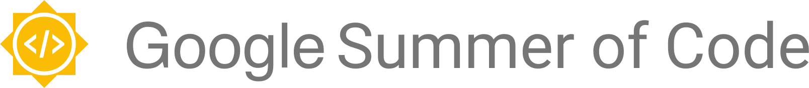

# The Beginners Guide to Google Summer of Code (GSoC) 

## Introduction
Google Summer of Code (GSoC) is a global program sponsored and managed by Google. Its primary goal is to introduce students and beginners to open source software development. During the program, contributors work with an open-source organization under the guidance of experienced mentors on a structured three-month coding project. Contributors who successfully complete the program receive a stipend from Google.

## Motivation
Many students—especially college juniors—frequently reach out with questions such as:
* What is GSoC?
* Am I eligible?
* How do I start preparing?

This guide was created to bring all essential information and resources into one place, making it easier for beginners around the world to understand and prepare for GSoC. In this repo, I'll try to provide you with accurate information, resources and examples so that it helps you to get into GSoC.

## Table of Contents
* [What is Open Source](#what-is-open-source)
	* [Why Should we Care](#why-should-we-care)
	* [How to make a contribution](#how-to-make-a-contribution)
	* [Difference between Open Source, Freeware and Other Softwares](#difference-between-open-source-freeware-and-other-softwares)
* [What is git and GitHub](#what-is-git-and-github)
	*  [Version control systems](#version-control-systems)
* [What is Google Summer of Code](#what-is-google-summer-of-code)
	* [Eligibility criteria](#eligibility-criteria)
	* [Am I good Enough](#am-i-good-enough)
	* [Benefits of GSoC](#benefits-of-gsoc)
	* [Required Skills](#required-skills)
* [How to Start](#how-to-start)
	* [Selecting the Project and Organization](#selecting-the-project-and-organization)
	* [Understanding the Project](#understanding-the-project)
	* [Drafting the Project Proposal](#Drafting-the-project-proposal)
	* [Getting Selected](#getting-selected)
* [Useful Links](#useful-links)
* [Terminologies](#terminologies)

## What is Open Source
Open source software is software whose source code is publicly available. Anyone can:
* View the code
* Modify it
* Redistribute it (under the rules of the license)
Common Examples of Open Source Software:
* Mozilla Firefox
* VLCMedia Player
* Linux distributions

### Why Should we Care
**Why Should we care if the software is open source?**
1. Transparency – Public code reduces the risk of hidden malicious behavior
2. Community-driven – Built and maintained by developers worldwid
3. Free and Flexible – Usually free to use and highly customizable
4. Learning Opportunity – Real-world experience on production-level software
Many large companies also rely on open source software—for example, Microsoft Edge is based on Chromium. 

### How to make a contribution
Before contributing, you should be familiar with:
* Git and GitHub
* At least one programming language
* Bug tracking tools
* Community communication platforms (Slack, IRC, GitHub Issues)
  
 ### Steps to Start Contributing:
1. Understand the project and its goals
2. Join the project’s community
3. Look for beginner-friendly issues
4. Fix bugs or improve documentation
5. Submit a Pull Request (PR)

If you are completely new, you can start with:
* firstcontributions on GitHub
* firsttimersonly.com

### Difference between Open Source, Freeware and Other Softwares
* **Open Source Software** - The source code of these software's is freely available to its users, and anyone can modify and redistribute it. This software use open source licenses which don't have any licensing fee. E.g., Mozilla Firefox web browser.

* **Freeware Softwares** - These are the software that is free to use. However, their source code is not available and is protected with proprietary rights, licenses, and copyrights. E.g., WinRAR.

* **Proprietary software** - These are the software's that are not free to use, and their source code is protected with proprietary rights, license, and copyright. The user needs to pay a specific amount to use the software. They often have limitations on their use; e.g., it can be installed only on one PC. This software is also called closed-source software. E.g., Microsoft Office.

## What is git and GitHub
* Git is an open-source version control system that tracks changes in code
* GitHub is a hosting platform for Git repositories
  
## Benefits of Version Control Systems:
* Track and revert changes
* Work efficiently in teams
* Maintain a clear history of code updates

### Version control systems
**What are version control systems?**
The version control system is a category of software tools that keeps track of changes done to a file/files over time.
The main benefit it provides is that at any time we can view/revert to any available versions of a file while other benefits are branching, merging, and traceability.

To read about version control systems in detail, visit [Getting Started about version control](https://git-scm.com/book/en/v2/Getting-Started-About-Version-Control) or [What is version control](https://www.atlassian.com/git/tutorials/what-is-version-control).

## What is Google Summer of Code

GSoC is a structured program where contributors:
* Work on an open-source project
* Are guided by mentors
* Undergo three evaluation phases
* Receive stipends after successful evaluations

### Eligibility criteria

To participate in GSoC, you must:
* Be at least 18 years old
* Be a student or a beginner in open source
* Not have completed GSoC more than two times previously
* GSoC has been open to non-students since 2023.
 
**UPDATE:** Google recently announced that starting in 2023, GSoC is being opened to contributors new to open source software development (and not just to students anymore). **[Official blog post announcing the changes -  Get ready for Google Summer of Code 2023!](https://opensource.googleblog.com/2022/11/get-ready-for-google-summer-of-code-2023.html)**.

#### **Requirements** - To participate in the program, a GSoC Contributor must:
1. be eighteen (18) years of age or older upon registration for the Program;
2. for the duration of the Program, be eligible to work in the country in which they reside;
3. not be an Organization Administrator or Mentor in the Program; and
4. be a student or a beginner to open source software development.

#### **Ineligible Individuals** - A GSoC Contributor may not participate in the Program if:

1. They are:
	1. a resident of a United States embargoed country;
	2. ordinarily resident in a United States embargoed country; or
        3. otherwise prohibited by applicable export controls and sanctions programs.

2. They are an employee (including intern), contractor, officer, or director of:
	1. Google or its affiliates, or
        2. an Organization or any of its affiliates.
3. They are an immediate family member (including a parent, sibling, child, spouse, or life partner) of a Mentor or Organization Administrator with the same Organization or a member of the same household (whether related or not) as a Mentor or Organization Administrator with the same Organization.
4. They have previously participated as a GSoC Student or GSoC Contributor in Google Summer of Code two (2) or more times.

To know the complete rules visit the [GSoC Rules Page](https://summerofcode.withgoogle.com/rules/).

### Am I good Enough

If you:
* Have basic programming knowledge
* Understand Git and GitHub
* Are willing to learn and adapt
* Then you are good enough.

GSoC is designed for learners, not experts.
If you are familiar with the technologies mentioned in the section - [How to make a contribution](#how-to-make-a-contribution), have experience contributing to open source and know how to program, then you are good to go.

There are various other skills required to plan for the project and complete the project. However, you'll learn them on the way.

There is more information available on the context at [GSoC Guides](https://google.github.io/gsocguides/student/am-i-good-enough).

### Benefits of GSoC
There are various benefits of completing GSoC.
* 🌍 Global recognition
* 💰 Competitive stipend
* 🤝 Strong professional network
* 🧠 Hands-on industry experience
* 👕 Official GSoC swag
* 👨‍🏫 Opportunity to become a mentor in the future

* The recognition: GSoC is recognized worldwide, so when applying for jobs you'll get an advantage. However, GSoC students are more preferred by Startups than well-established organizations because, in startups like GSoC, you have to learn new skills and technologies very fast and become good at them.

* The network: After completing GSoC you now have many connections which help you and can provide recommendations when needed.
* The Stipend: They pay well.
* The referral: After completing the program you are given a one-time referral which you can use within 6 years for any job at Google.
* The Exposure: When working on the project with experienced developers, you get to learn a lot and get the industry's exposure.
* The Swag: What do developers like more than swag or goodies. You'll get a GSoC T-shirt and a certificate.
* Chance to Mentor: You can also be a mentor the next time or in GCI by Google.

### Required Skills
A Few of the skills are mentioned in the section - [How to make a contribution](#how-to-make-a-contribution). E.g., git, GitHub, a programming language, basic knowledge of IRC(Internet Relay Chat), Basic knowledge of Bug tracking tools, git, and GitHub.

You should also be familiar with the basics of [Software/System development life cycle](https://en.wikipedia.org/wiki/Systems_development_life_cycle) (This will help you in drafting an impressive and detail-oriented project proposal), MS Word/Google Docs.

Also, the knowledge of the skills required for the project would be an added advantage.

E.g. An example from my project proposal.

	The basic tasks required for this project involves creating python/shell scripts, 
	working with LetsEncrypt and OpenSSL, creating and modifying configuration files, 
	working with Libreswan. I’ve worked on all of the above-mentioned tasks, some in 
	my projects(including Libreswan Managing Interface) and on some while contributing 
	to other open-source projects.

## How to Start
The most challenging part of GSoC is Stage 1 - "The journey from the beginning to selecting the project of your interest". This is the most frustrating part where the students have to search for various projects and see if they are interested in them. Also, this is the stage where most of the aspiring GSoC students quit.

The most common mistake students make in this stage is that they limit their search to specific programming languages. They only search for projects in a specific programming language rather than searching for the project of their interest. 

**Why should you choose a project based on your interest?**

Do not choose a project only based on the programming language.
1. Instead, choose a project based on your interest, because:
2. Languages can be learned, interest cannot be forced
3. Genuine interest leads to a stronger proposal

Interest helps you stay motivated during difficult phases
There are two reasons for this:
1. If you know, programming, then the language should not be a barrier in selecting the projects. You should be adaptive and fast learners, and these skills matter in GSoC.
2. It will help you in drafting a good proposal. If you are interested in the project, then you'll learn a lot about it and will explore it. However, if you select a project based on language, then you'll do the necessary required stuff and that so without much interest. 
3. During the program, there will be times when you'd want to quit. The project will be getting hard, and you'll have a difficult time keeping up with it. At this point, it's only the interest that will keep you going, and if you had selected the project based on language with no interest in it, then you'll inevitably quit. I've seen many GSoC students quit the project because the project has become hardened, and they don't have an interest in it.

### Selecting the Project and Organization
**How to select the project or organizations?**

This stage of searching won't be easy, so you have to be patient. 

First of all, you need to choose an organization (which might be doing work related to your interests) for that the best way is to visit [GSoC Archive](https://summerofcode.withgoogle.com/archive/) and see the completed projects and then visit the website of the organization and searching for GSoC projects. If you didn't find any of the projects listed, then you can contact the organization members and ask them about the projects. This process will take weeks, but it is a sure way you can find the projects of your interest. 

Note - 

* Don't forget to ask the organizations members whether they'll be taking part in the next GSoC or not.
* Start searching the archive in the order latest to oldest i.e., 2019 to 2009.

I had written a blog post describing my experience when I was in the stage of searching for the project and organization. [GSoC - Selecting the project and organization
](https://therishabh.in/gsoc_selecting_the_project_and_organization/)

### Understanding the Project
Once you have completed Stage 1 ([Selecting the Project and Organization](#selecting-the-project-and-organization)), then the next thing is to understand the project, organization, and development technologies used by the organization.

Once you shortlist an organization:
* Study its previous GSoC projects
* Read documentation and repositories
* Communicate with mentors and community members
* Start contributing by fixing beginner-level issues

Early contributions significantly improve your chances of selection.If your project is new and hasn't been started yet, then it's better to learn about it as much as you can, the organization members can help you with it. This thing happened to me in GSoC 2018, my project wasn't started, and the GSoC task was to build it. I gather information about it as much as I can and then drafted the project proposal. During the process, I was continuously asking questions and clearing my doubts about the project by asking them to the organization Admin. You can also contribute to other organization projects if it helps in GSoC, ask the organization members about it.

I had written a blog post about the same. [GSoC - Initial phase and getting selected](https://therishabh.in/gsoc_initial_phase_and_getting_selected/)

### Drafting the Project Proposal
Drafting the Project Proposal is the most critical part of GSoC, as all your efforts and progress until now depend on the proposal. Everything you've learned from the mentors, community, peers about the project should reflect in the project proposal. If you've learned a lot about the project and that too in detail, but you fail to represent all that in the proposal, then it won't help you.

Usually, organizations have their project proposal formats, and it's good if you stick to them. But if your organization doesn't have a project proposal format, then below are a few things you can include in your project proposal:

* **Background** - A little ( <150 words) background always helps. You can also add it to the description section of the GSoC dashboard.
* **Objectives** - Clear and concise objectives will help others (including organization members) understand your project-related goals better.
* **Technical Components/Modules** - It is always better to divide the whole project into a few (<10) components. It'll help you and your mentor to keep track of your progress, and you'll be able to achieve the Objectives in a precise and planned way.
* **Sub components/sub modules** - Further divide the components and modules into sub-components and sub-modules to the point that each sub-module is an independent entity/task.
* **Use references** -  When explaining any task/module it's better to provide some references. A reference can be a code snippet of similar nature (i.e., it represents some similar implementation) from the same or different project.
* **Timeline** - It is distributing all the above tasks/components/modules over 12 weeks.
* **Evaluation** - It just represents the above timeline in GSoC Evaluation periods. So, you and your mentors can track how many tasks are completed in a specific period.
* **Personal** - You can also include some essential personal information.
* **Social Profiles** - You can mention the links to your GitHub, Website, etc. and your email address.
* **Timezone** - It'll help your mentor to schedule calls/meetings with you.
* **Some Essential Information** - The information like your comfort working with a remotely available mentor, Your native language, Are you likely to finish the project in the allotted time, etc. will help you a lot.

I've attached a [sample proposal for your reference](https://www.devdisplay.org/OpenSource/gsoc).

### Getting Selected
If you get selected then you'll be able to see various details and options in the GSoC dashboard, and you'll get an email from Google open source regarding the next steps; you have to follow them. And the best thing is you'll get some time for community bonding with the organization and mentors, use that time to clear all your doubts (if any) regarding the project, organizations, etc. This is an excellent time to discuss your roadmap (Timeline) with your mentors and fix slots for weekly or bi-weekly meetings.

If you are not selected for the project, introspect and try to know the reasons for your failure and ask yourself a question "Why do you want to be a Google Summer of Code Student?". Learn from those failures and try again.

Remember one thing "Success consists of going from failure to failure without loss of enthusiasm." - Winston Churchill

### What If You Are Not Selected?
If you are not selected:
* Do not get discouraged
* Analyze what went wrong
* Improve your preparation

Apply again next year

“Success consists of going from failure to failure without loss of enthusiasm.”
— Winston Churchill

## Final Advice
* GSoC is not a sprint—it is a marathon.
* Consistency, patience, curiosity, and genuine interest matter more than prior expertise.  ye bhi likhu kya

## Useful Links
1. [An Introduction to Open Source](https://www.digitalocean.com/community/tutorial_series/an-introduction-to-open-source)
2. [Learn about git and GitHub](https://product.hubspot.com/blog/git-and-github-tutorial-for-beginners)
3. [GSoC Guides](https://google.github.io/gsocguides/student/)
4. [Introduction to Open Source - A Series by DigitalOcean](https://www.digitalocean.com/community/tutorial_series/an-introduction-to-open-source)
5. [Contribute to Open Source. Search issue labels to find the right project for you!](https://github.com/despo/issuehub.io)
6. [Awesome First PR Opportunities](https://github.com/mungell/awesome-for-beginners)
7. [How to Contribute to Open Source](https://opensource.guide/how-to-contribute/)

## Terminologies
1. **patch** - It is a set of changes to a computer program or its supporting data designed to update, fix, or improve it.
2. **commit** - A single unit of code changes is called a commit. A PR (Pull Request) consists of one or more commits.
3. **PR** - PR stands for Pull Request. It's a synonym for a patch in Open Source terminology.
4. **repo** - It is a short form for the word repository. A repository is a place where things are stored and can be found.

## Contribute
Do you have something to share? 
Open an Issue or Create PR.

## License
This project is licensed under [MIT License](https://github.com/codeaashu/GSOC-The-Beginners-Guide/blob/main/LICENSE)
